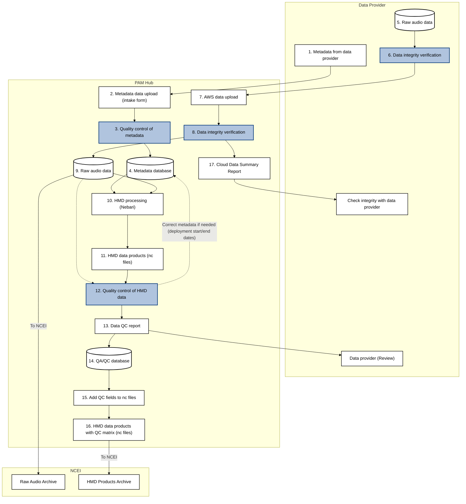

# PAMHUB User Manual

## Metadata Handling

!!! TODO
    The list below needs elaboration and examples.

- Define the types of metadata collected
  - Platform, Deployment, Project, ????
- Provide metadata to the PAM Analyst (email, FTP etc.)
- PAM Analyst will review the metadata and standardize it according to the metadata model documented here.
  - Links to [PARS](https://passiveacoustics.fisheries.noaa.gov/pars/guide/metadata.html)
  - Links to Tugboat [API docs](https://ccog.colorado.edu/tugboat/swagger-ui/index.html)
  - Links to NCEI archiving [best practices](https://www.ncei.noaa.gov/products/passive-acoustic-data#tab-3561)
  - Links to any other reference that informed the metadata model implemented in PAMHUB.
  - Links to csv templates for Data Providers
- PAM Analyst will work iteratively with the data provider to ensure the metadata is of sufficient quality to support all of the PAMHUB use cases (e.g. archiving data and derived products, calculating spectograms and creating HMD files, calculating climatological soundscape metrics, detecting species presence or absence, etc.)

    
## Uploading Raw Audio Files

TODO: Copy content from Issue [#3](https://github.com/asascience-open/pam-cloud/issues/3)

## Quality control of audio files or metadata within the PAMHUB system

## Creation of HMD files

## Quality Control of HMD Files

